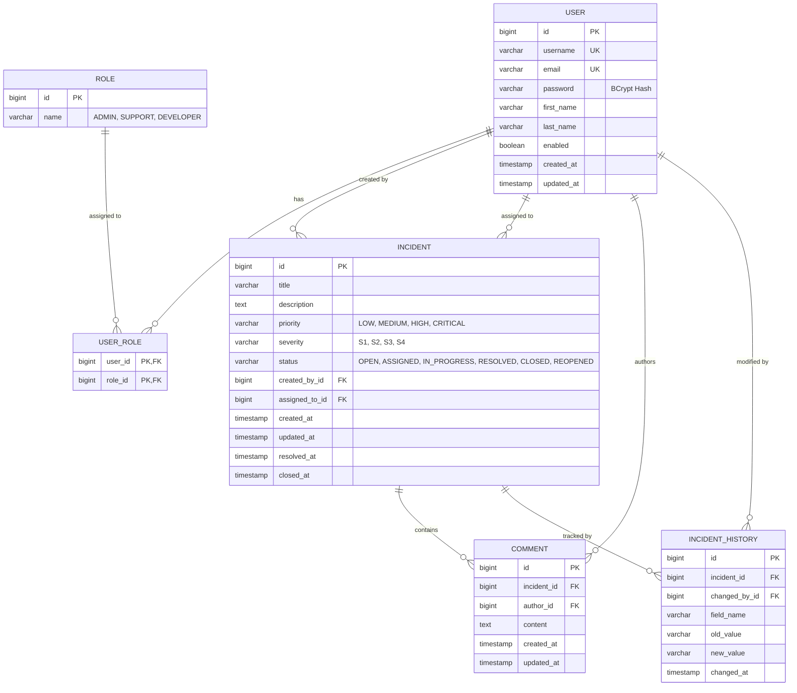
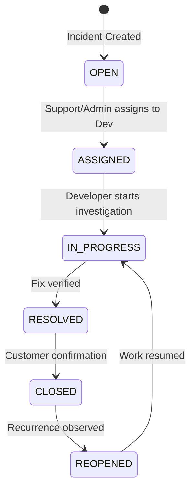

# IncidentSphere — Enterprise Issue & Incident Management System

[](https://github.com/nandhubabu/Enterprise-Issue---Incident-Management-System/actions/workflows/ci.yml)
[](https://opensource.org/licenses/Apache-2.0)
[](https://spring.io/projects/spring-boot)
[](https://openjdk.org/)
[](https://www.postgresql.org/)
[](https://react.dev/)

A production-grade, multi-tier enterprise incident management and issue tracking platform. Engineered with a decoupled architecture featuring a **Java 21 / Spring Boot 3.3** REST backend, a responsive **React 18** single-page application, and an ACID-compliant **PostgreSQL 16** persistence layer, all fully containerized using **Docker Compose** with **GitHub Actions CI/CD** automation.

---

## Table of Contents
1. [Overview & Business Objectives](#1-overview--business-objectives)
2. [Key Features](#2-key-features)
3. [Architecture Overview](#3-architecture-overview)
4. [Technology Stack](#4-technology-stack)
5. [System Design & Entity Relationship](#5-system-design--entity-relationship)
6. [Incident Workflow Finite State Machine](#6-incident-workflow-finite-state-machine)
7. [Authentication & RBAC Permission Matrix](#7-authentication--rbac-permission-matrix)
8. [REST API Documentation & Swagger](#8-rest-api-documentation--swagger)
9. [Automated Testing Strategy](#9-automated-testing-strategy)
10. [Docker Containerization](#10-docker-containerization)
11. [GitHub Actions CI/CD Pipelines](#11-github-actions-cicd-pipelines)
12. [Production Support & Observability](#12-production-support--observability)
13. [Environment Configuration](#13-environment-configuration)
14. [How to Run Locally](#14-how-to-run-locally)
15. [Future Enhancements](#15-future-enhancements)

---

## 1. Overview & Business Objectives

Technical outages and software defects require immediate, auditable, and structured resolution between Customer Support, Engineering, and DevOps teams. IncidentSphere provides a unified platform where issues are categorized, assigned to specialized developers, tracked through a strict state machine, and audited with change-by-change history.

---

## 2. Key Features

- **Stateless JWT Security**: HMAC-SHA256 authenticated REST endpoints with token expiration and claims.
- **Strict Role-Based Access Control (RBAC)**: Fine-grained method-level security (`@PreAuthorize`) separating Admin, Support, and Developer privileges.
- **Finite State Machine Workflow Engine**: Enforces valid incident status transitions (`OPEN` → `ASSIGNED` → `IN_PROGRESS` → `RESOLVED` → `CLOSED`; `CLOSED` → `REOPENED` → `IN_PROGRESS`), rejecting illegal skips with `400 Bad Request`.
- **Dynamic Specification Search & Pagination**: Multi-criteria search across keyword, status, priority, severity, and engineer assignment with paginated and sorted payloads.
- **Engineering Collaboration & Discussion**: Real-time team commentary on technical incidents with author authorization controls.
- **Automated Entity Auditing & History**: Tracks who changed which field, previous value, new value, and timestamps.
- **Production Support & Tracing**: Distributed request tracing with `X-Correlation-ID` in SLF4J MDC, Logback daily rolling file appenders, and Spring Boot Actuator health checks.

---

## 3. Architecture Overview

```text
┌─────────────────────────────────────────────────────────────┐
│              Browser / Client Applications                  │
└──────────────────────────────┬──────────────────────────────┘
                               │ HTTP / JSON
                               ▼
┌─────────────────────────────────────────────────────────────┐
│                    NGINX Reverse Proxy                      │
│                                                             │
│ • Serves React 18 SPA (HTML5 PushState Routing)             │
│ • Proxies /api/* to Spring Boot Backend                     │
│ • Proxies /actuator/* for Health & Metrics                  │
└──────────────────────────────┬──────────────────────────────┘
                               │
                               ▼
┌─────────────────────────────────────────────────────────────┐
│                 Spring Boot 3.3 REST API                    │
│                                                             │
│ • MdcCorrelationFilter (X-Correlation-ID)                   │
│ • JwtAuthenticationFilter (OncePerRequestFilter)            │
│ • SecurityFilterChain & Method Security (@PreAuthorize)    │
│ • GlobalExceptionHandler (@RestControllerAdvice)            │
│ • Controllers (Auth, Incident, Comment, User)               │
│ • Service Layer & Status Transition Engine                  │
│ • Spring Data JPA & Dynamic Specifications                  │
└──────────────────────────────┬──────────────────────────────┘
                               │ JDBC / HikariCP Pool
                               ▼
┌─────────────────────────────────────────────────────────────┐
│                    PostgreSQL 16 Database                   │
│                                                             │
│ • ACID Transactions                                         │
│ • Indexes on status, priority, severity, assigned_to_id     │
│ • Automated JPA Auditing                                    │
└─────────────────────────────────────────────────────────────┘
```

---

## 4. Technology Stack

| Domain | Technology | Description |
|---|---|---|
| **Backend Framework** | Spring Boot 3.3.4 | Core enterprise application framework |
| **Language** | Java 21 LTS | Records, Pattern Matching, Switch Expressions |
| **ORM / Persistence** | Spring Data JPA / Hibernate | Object-Relational Mapping & Specification queries |
| **Relational Database** | PostgreSQL 16 | Production transactional database |
| **Dev Database** | H2 In-Memory DB | Offline dev fallback & integration tests |
| **Security** | Spring Security 6 & JJWT 0.12.6 | Stateless JWT authorization & BCrypt hashing |
| **API Docs** | SpringDoc OpenAPI 3 / Swagger | Interactive API contract and testing sandbox |
| **Testing** | JUnit 5 & Mockito & MockMvc | Comprehensive unit and integration test suites |
| **Frontend Framework** | React 18 | Declarative single-page application |
| **Build Tool (UI)** | Vite 5 | Fast HMR development and rollup bundle packaging |
| **Styling** | Vanilla CSS Design System | Curated dark glassmorphism, responsive tokens |
| **Icons** | Lucide React | Modern iconography |
| **Containerization** | Docker & Docker Compose | Multi-stage container builds |
| **CI/CD** | GitHub Actions | Continuous Integration and Automated Delivery |

---

## 5. System Design & Entity Relationship



---

## 6. Incident Workflow Finite State Machine



- **Permitted Transitions**:
  - `OPEN` → `ASSIGNED`
  - `ASSIGNED` → `IN_PROGRESS`
  - `IN_PROGRESS` → `RESOLVED` (Sets `resolvedAt = NOW`)
  - `RESOLVED` → `CLOSED` (Sets `closedAt = NOW`)
  - `CLOSED` → `REOPENED` (Clears `resolvedAt` & `closedAt`)
  - `REOPENED` → `IN_PROGRESS`
- **Rejection Policy**: Illegal transitions (e.g. `OPEN` → `CLOSED`) produce `400 Bad Request`:
  ```json
  {
    "status": 400,
    "error": "INVALID_STATUS_TRANSITION",
    "message": "Incident cannot move from OPEN to CLOSED"
  }
  ```

---

## 7. Authentication & RBAC Permission Matrix

| Operation | Endpoint | Admin | Support | Developer |
|---|---|:---:|:---:|:---:|
| **Register & Login** | `POST /api/auth/*` | :white_check_mark: | :white_check_mark: | :white_check_mark: |
| **Create Incident** | `POST /api/incidents` | :white_check_mark: | :white_check_mark: | :white_check_mark: |
| **Search / View Incidents** | `GET /api/incidents/**` | :white_check_mark: | :white_check_mark: | :white_check_mark: |
| **Assign Incident** | `PATCH /api/incidents/{id}/assign` | :white_check_mark: | :white_check_mark: | :x: |
| **Update Incident Details** | `PUT /api/incidents/{id}` | :white_check_mark: | :white_check_mark: | :white_check_mark: |
| **Change Status** | `PATCH /api/incidents/{id}/status` | :white_check_mark: | :white_check_mark: | :white_check_mark: |
| **Add / View Comments** | `POST/GET /api/incidents/{id}/comments` | :white_check_mark: | :white_check_mark: | :white_check_mark: |
| **Delete Own Comment** | `DELETE /api/comments/{id}` | :white_check_mark: | :white_check_mark: (own) | :white_check_mark: (own) |
| **Delete Incident** | `DELETE /api/incidents/{id}` | :white_check_mark: | :x: | :x: |
| **Manage Users & Roles** | `GET/PUT/DELETE /api/users/**` | :white_check_mark: | :x: | :x: |

---

## 8. REST API Documentation & Swagger

Interactive Swagger UI documentation is available at:
`http://localhost:8080/swagger-ui.html`

### Sample Request: Create Incident
```http
POST /api/incidents HTTP/1.1
Host: localhost:8080
Authorization: Bearer <JWT_TOKEN>
Content-Type: application/json

{
  "title": "Payment Webhook Timeout on Peak Traffic",
  "description": "Connections timeout when handling batch events above 2000 RPS.",
  "priority": "CRITICAL",
  "severity": "S1"
}
```

### Sample Response: `201 Created`
```json
{
  "id": 1,
  "title": "Payment Webhook Timeout on Peak Traffic",
  "description": "Connections timeout when handling batch events above 2000 RPS.",
  "priority": "CRITICAL",
  "severity": "S1",
  "status": "OPEN",
  "createdBy": {
    "id": 2,
    "username": "support",
    "email": "support@enterprise.com",
    "firstName": "Alex",
    "lastName": "Support"
  },
  "assignedTo": null,
  "commentsCount": 0,
  "createdAt": "2026-10-22T14:35:00.000Z",
  "updatedAt": "2026-10-22T14:35:00.000Z"
}
```

---

## 9. Automated Testing Strategy

The repository maintains an automated unit and integration test suite executing 34 automated tests across core business logic and REST controllers:

- **Unit Tests**:
  - `AuthServiceTest`: Validates registration, duplicate constraints, BCrypt hashing, and JWT creation.
  - `IncidentServiceTest`: Validates incident creation, ID lookups, assignment, updates, and deletion.
  - `StatusWorkflowTest`: Parameterized validation of all 6 valid state transitions and rejection of 8 invalid transition attempts.
  - `CommentServiceTest`: Validates comment creation, author ownership verification, and administrative deletion.
- **Integration Tests**:
  - `IncidentControllerIntegrationTest`: End-to-end execution testing unauthenticated rejection (401), registration, login, incident creation, status progression, invalid transitions (400), and dynamic filtering.

To run tests:
```bash
cd backend
mvn test
```

---

## 10. Docker Containerization

Run the complete multi-tier application stack with a single command:

```bash
docker compose up -d --build
```

Compose starts 3 coordinated containers:
1. `incident_postgres`: PostgreSQL 16 database with health check and initialization scripts.
2. `incident_backend`: Spring Boot 3 on Eclipse Temurin JRE 21.
3. `incident_frontend`: NGINX Alpine serving the optimized React 18 production build with reverse proxy.

Access points:
- **Web Application**: `http://localhost:80`
- **Backend API**: `http://localhost:8080/api`
- **Swagger Docs**: `http://localhost:8080/swagger-ui.html`

---

## 11. GitHub Actions CI/CD Pipelines

Two automated workflows are configured in `.github/workflows/`:
1. **`ci.yml`**:
   - Compiles and runs all JUnit 5 & Mockito test suites on Java 21.
   - Builds and bundles the React frontend via Vite.
   - Validates multi-stage Docker builds.
2. **`cd.yml`**:
   - Triggered on releases or merges to `main`.
   - Packages and pushes versioned images to GitHub Container Registry (`ghcr.io`).

---

## 12. Production Support & Observability

- **MDC Correlation IDs**: Every inbound request receives an `X-Correlation-ID` header, attached to thread-local MDC for log tracing.
- **Logback Rolling Files**: Logs rotate daily and when reaching 50MB with 30-day retention in `backend/logs/`.
- **Spring Boot Actuator**: Health metrics exposed on `/actuator/health` and `/actuator/info`.
- **Audit Logging**: Every status transition or assignment creates an `IncidentHistory` record.

---

## 13. Environment Configuration

Copy the example file to configure production secrets:
```bash
cp .env.example .env
```

| Variable | Default Value | Description |
|---|---|---|
| `DB_HOST` | `postgres` (or `localhost`) | PostgreSQL hostname |
| `DB_PORT` | `5432` | PostgreSQL port |
| `DB_NAME` | `incidentdb` | Database name |
| `DB_USERNAME` | `postgres` | Database username |
| `DB_PASSWORD` | `postgres` | Database password |
| `JWT_SECRET` | *Preconfigured 256-bit key* | Signing secret for JWTs |
| `SPRING_PROFILES_ACTIVE` | `prod` (or `dev`) | Spring active profile |

---

## 14. How to Run Locally

### Default Seeded Test Accounts
For instant evaluation:

| Role | Username | Password | Privileges |
|---|---|---|---|
| **Admin** | `admin` | `admin123` | Full access: users, incidents, deletion |
| **Support** | `support` | `support123` | Create, view, assign, status, comments |
| **Developer** | `developer` | `dev123` | View assigned, update status, comments |

### 1. Run Backend Locally
```bash
cd backend
mvn spring-boot:run
```

### 2. Run Frontend Locally
```bash
cd frontend
npm install
npm run dev
```
Navigate to `http://localhost:5173`.

---

## 15. Future Enhancements

- WebSocket push notifications for real-time comment and status updates.
- SLA policy engine with automated escalation timers for Critical (S1) outages.
- Multi-tenant organization support.
- File and screenshot attachments stored in AWS S3 / MinIO.
