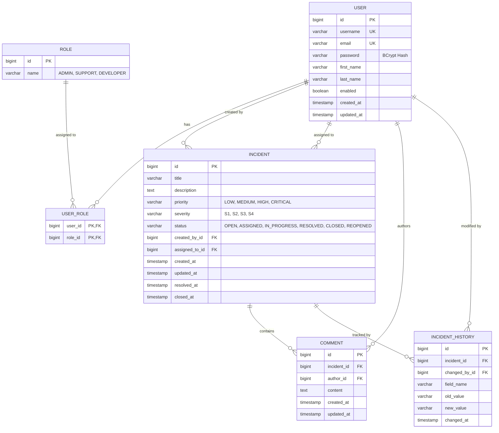

# Entity Relationship Diagram & Database Schema Specification

## 1. Entity Relationship (ER) Diagram



---

## 2. PostgreSQL Relational DDL Specifications

```sql
-- Role Table
CREATE TABLE roles (
    id BIGSERIAL PRIMARY KEY,
    name VARCHAR(50) NOT NULL UNIQUE
);

-- User Table
CREATE TABLE users (
    id BIGSERIAL PRIMARY KEY,
    username VARCHAR(100) NOT NULL UNIQUE,
    email VARCHAR(150) NOT NULL UNIQUE,
    password VARCHAR(255) NOT NULL,
    first_name VARCHAR(100) NOT NULL,
    last_name VARCHAR(100) NOT NULL,
    enabled BOOLEAN NOT NULL DEFAULT TRUE,
    created_at TIMESTAMP WITH TIME ZONE DEFAULT CURRENT_TIMESTAMP,
    updated_at TIMESTAMP WITH TIME ZONE DEFAULT CURRENT_TIMESTAMP
);

-- User-Role Mapping Table
CREATE TABLE user_roles (
    user_id BIGINT NOT NULL REFERENCES users(id) ON DELETE CASCADE,
    role_id BIGINT NOT NULL REFERENCES roles(id) ON DELETE CASCADE,
    PRIMARY KEY (user_id, role_id)
);

-- Incident Table
CREATE TABLE incidents (
    id BIGSERIAL PRIMARY KEY,
    title VARCHAR(255) NOT NULL,
    description TEXT NOT NULL,
    priority VARCHAR(50) NOT NULL,
    severity VARCHAR(50) NOT NULL,
    status VARCHAR(50) NOT NULL DEFAULT 'OPEN',
    created_by_id BIGINT NOT NULL REFERENCES users(id),
    assigned_to_id BIGINT REFERENCES users(id) ON DELETE SET NULL,
    created_at TIMESTAMP WITH TIME ZONE DEFAULT CURRENT_TIMESTAMP,
    updated_at TIMESTAMP WITH TIME ZONE DEFAULT CURRENT_TIMESTAMP,
    resolved_at TIMESTAMP WITH TIME ZONE,
    closed_at TIMESTAMP WITH TIME ZONE
);

-- Performance Indexes
CREATE INDEX idx_incidents_status ON incidents(status);
CREATE INDEX idx_incidents_priority ON incidents(priority);
CREATE INDEX idx_incidents_severity ON incidents(severity);
CREATE INDEX idx_incidents_assigned_to ON incidents(assigned_to_id);
CREATE INDEX idx_incidents_created_by ON incidents(created_by_id);
CREATE INDEX idx_incidents_created_at ON incidents(created_at);

-- Incident Comments
CREATE TABLE comments (
    id BIGSERIAL PRIMARY KEY,
    incident_id BIGINT NOT NULL REFERENCES incidents(id) ON DELETE CASCADE,
    author_id BIGINT NOT NULL REFERENCES users(id),
    content TEXT NOT NULL,
    created_at TIMESTAMP WITH TIME ZONE DEFAULT CURRENT_TIMESTAMP,
    updated_at TIMESTAMP WITH TIME ZONE DEFAULT CURRENT_TIMESTAMP
);

CREATE INDEX idx_comments_incident ON comments(incident_id);

-- Incident Audit History
CREATE TABLE incident_histories (
    id BIGSERIAL PRIMARY KEY,
    incident_id BIGINT NOT NULL REFERENCES incidents(id) ON DELETE CASCADE,
    changed_by_id BIGINT NOT NULL REFERENCES users(id),
    field_name VARCHAR(100) NOT NULL,
    old_value VARCHAR(255),
    new_value VARCHAR(255),
    changed_at TIMESTAMP WITH TIME ZONE DEFAULT CURRENT_TIMESTAMP
);

CREATE INDEX idx_histories_incident ON incident_histories(incident_id);
```
