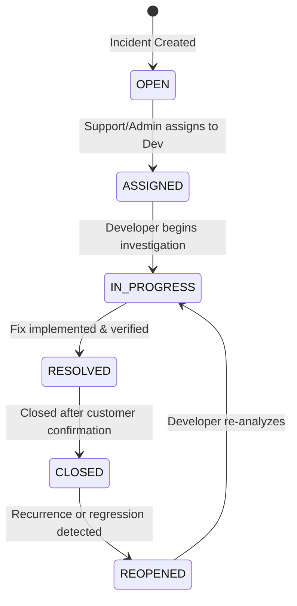

# Role-Based Access Control (RBAC) & Incident Workflow Specification

## 1. Role-Based Access Control (RBAC) Matrix

The system enforces strict principle-of-least-privilege RBAC. Authorization is validated both at the HTTP layer via Spring Security Filters and at the service/method layer using `@PreAuthorize`.

| Operation | HTTP Endpoint | Admin | Support | Developer |
|---|---|:---:|:---:|:---:|
| **Register / Authenticate** | `POST /api/auth/*` | Public | Public | Public |
| **Manage Users (List, Update, Disable)** | `GET/PUT/DELETE /api/users/**` | :white_check_mark: | :x: | :x: |
| **Create Incident** | `POST /api/incidents` | :white_check_mark: | :white_check_mark: | :white_check_mark: |
| **View Incidents (List, Detail)** | `GET /api/incidents/**` | :white_check_mark: | :white_check_mark: | :white_check_mark: |
| **Assign Incident to Developer** | `PATCH /api/incidents/{id}/assign` | :white_check_mark: | :white_check_mark: | :x: |
| **Change Priority** | `PUT /api/incidents/{id}` | :white_check_mark: | :white_check_mark: | :white_check_mark: |
| **Change Severity** | `PUT /api/incidents/{id}` | :white_check_mark: | :white_check_mark: | :white_check_mark: |
| **Change Status (Follows Workflow)**| `PATCH /api/incidents/{id}/status` | :white_check_mark: | :white_check_mark: | :white_check_mark: |
| **Add Comment to Incident** | `POST /api/incidents/{id}/comments` | :white_check_mark: | :white_check_mark: | :white_check_mark: |
| **Update Own Comment** | `PUT /api/comments/{id}` | :white_check_mark: | :white_check_mark: | :white_check_mark: |
| **Delete Comment** | `DELETE /api/comments/{id}` | :white_check_mark: | :white_check_mark: (own) | :white_check_mark: (own) |
| **Delete Incident** | `DELETE /api/incidents/{id}` | :white_check_mark: | :x: | :x: |

---

## 2. Incident Status Lifecycle & Workflow Engine

The incident lifecycle operates as a finite state machine. Transitions outside the verified graph are strictly rejected with an `INVALID_STATUS_TRANSITION` domain exception.



### 2.1 Permitted Transitions Table

| Current Status | Permitted Next Status | Condition / Business Rule |
|---|---|---|
| `OPEN` | `ASSIGNED` | Must supply valid `assignedTo` Developer ID |
| `ASSIGNED` | `IN_PROGRESS` | Initiated by assignee or support to mark active work |
| `IN_PROGRESS` | `RESOLVED` | Sets `resolvedAt = CURRENT_TIMESTAMP` |
| `RESOLVED` | `CLOSED` | Sets `closedAt = CURRENT_TIMESTAMP` |
| `CLOSED` | `REOPENED` | Clears `resolvedAt` and `closedAt` |
| `REOPENED` | `IN_PROGRESS` | Work resumes on the open defect |

### 2.2 Rejection Handling
Any transition not present in the transition map (e.g. `OPEN` → `CLOSED`, `ASSIGNED` → `CLOSED`, `RESOLVED` → `ASSIGNED`) throws:
- **HTTP Code**: `400 Bad Request`
- **Error Code**: `INVALID_STATUS_TRANSITION`
- **Payload Response**:
```json
{
  "timestamp": "2026-10-22T14:30:00Z",
  "status": 400,
  "error": "INVALID_STATUS_TRANSITION",
  "message": "Incident cannot move from OPEN to CLOSED"
}
```
