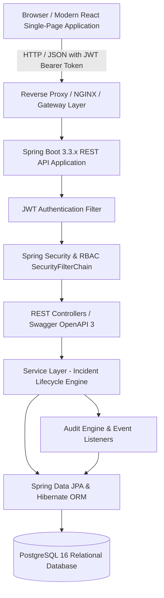

# System Architecture — Enterprise Issue & Incident Management System

## 1. High-Level Architecture Overview

The Enterprise Issue & Incident Management System is engineered as a decoupled, multi-tier, microservice-ready enterprise web application. It bridges real-time incident resolution operations between Support Engineers, Software Developers, and System Administrators.

---

## 2. Component Specifications

### 2.1 Presentation Layer (Frontend)
- **Framework**: React 18+ SPA with Vite.
- **Styling**: Vanilla CSS Design System with CSS Custom Properties, sleek dark/light palette, glassmorphism, responsive grid layouts, and micro-interactions.
- **State & Networking**: Native Fetch API / Axios with JWT interceptors for automatic Bearer token injection, proactive token expiry handling, and unified error notifications.
- **Routing**: Role-guarded client routes (`/login`, `/dashboard`, `/incidents`, `/incidents/:id`, `/incidents/new`, `/users`).

### 2.2 API & Security Layer (Spring Boot)
- **Spring Boot 3.3.x** on **Java 21 LTS**.
- **Stateless Authentication**: JSON Web Tokens (HMAC-SHA256 / SHA512) containing user subject, ID, email, and granted roles.
- **Authorization Engine**: Role-Based Access Control (RBAC) enforced via `@PreAuthorize` method security and `SecurityFilterChain` HTTP matcher rules.
- **API Documentation**: SpringDoc OpenAPI 3 / Swagger UI embedded for live interactive testing.

### 2.3 Domain & Business Logic Layer
- **Status Workflow State Machine**: Validates transitions across `OPEN`, `ASSIGNED`, `IN_PROGRESS`, `RESOLVED`, `CLOSED`, and `REOPENED`. Invalid transitions fail with `INVALID_STATUS_TRANSITION` domain exceptions.
- **Audit Logging Engine**: Automatic entity auditing capturing creator, assigned engineer, state transitions, old vs new values, and timestamps.
- **Dynamic Filtering Specification**: JPA Criteria-based queries handling multi-field filtering (`status`, `priority`, `severity`, `assignedTo`, `search keyword`) with paginated, sorted payloads.

### 2.4 Data Persistence Layer
- **PostgreSQL 16**: ACID-compliant transactional persistence.
- **ORM**: Spring Data JPA & Hibernate with tuned connection pooling (HikariCP), query indexing, and entity fetch strategies preventing N+1 queries.
- **Database Migrations & Initial Setup**: SQL DDL scripts (`database/init.sql`) provisioning schemas, indexes, and seeded administrator/support/developer accounts.
